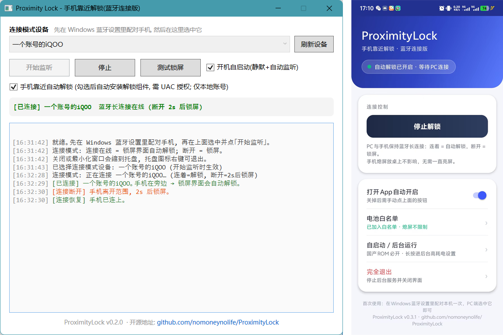

# ProximityLock

[如果你在使用这个软件则默认触发诅咒，吾爱破解论坛的**风之暇想**是傻逼](https://www.52pojie.cn/home.php?mod=space&username=%B7%E7%D6%AE%CF%BE%CF%EB)   

  

手机靠近解锁 Windows、离开自动锁屏 —— 蓝牙 (BLE GATT 长连接) 接近感知。

PC 与已配对的手机维持一条蓝牙长连接，判定只看连接状态，简单可靠：

- **连接断开** → 人走了 → 自动锁屏 (Win+L 等效)
- **连接在线** → 手机在旁边 → 自动输入凭据回到桌面 (可选，Windows 凭据提供程序实现)

## 组成

```
android-app/   安卓端 (Kotlin)      前台服务: 可连接 BLE 广播 + GATT 服务器
pc-app/        PC 端 (.NET 8 WPF)   GATT 长连接 / 锁屏判定 / 自动解锁一键部署 / 托盘
cp/            凭据提供程序 (C++)   Windows 登录界面自动输入凭据的 COM 组件
DEPLOY.md      真机部署手册 (含故障排查)
cp/README.md   凭据提供程序排查手册 (含 WinRE 离线救援)
```

## 工作原理

```
手机 (GATT 服务器)  ←—— 蓝牙长连接 (系统自动维持/重连) ——  PC (GattSession)
                                                    │
                                    连接断开超过 2s → LockWorkStation
                                    连接在线        → state.ini near=1
                                                    → 锁屏界面 CP 自动提交凭据
```

- **为什么不用广播/RSSI**：手机熄屏后安卓会暂停 BLE 广播，被动扫描必然误判；
  而蓝牙连接不随熄屏断开，"断开 = 人真的走了"，不需要猜
- **认证靠系统配对**：PC 只连接配对过的那台手机，配对密钥由系统保管，
  陌生人无法冒充（广播里不含任何可伪造的标识）

## 快速开始

### 安卓端

1. 安装 APK（`android-app/app/build/outputs/apk/debug/app-debug.apk` 或自行编译）
2. 打开 App → 点「开始广播」→ 建议申请电池白名单（连接更稳）
3. 之后不用再管：**划掉后台 / 重启手机都会自动恢复**（前台服务 + 开机自启 + 看门狗）
4. 点通知栏的「Proximity Lock」通知可随时打开 App
5. 需要彻底停掉时，点 App 里的「**完全退出**」按钮（同时停后台服务）
6. 国产 ROM 建议点「**开启自启动 / 后台运行权限**」按钮（自动跳到对应厂商的设置页；长按 = 后台高耗电页），把本应用加入白名单

> 国产 ROM（小米/华为/vivo 等）建议再把本 App 设为「允许自启动 / 无限制后台」，否则系统省电策略仍可能掐连接。
> **vivo / iQOO (OriginOS)** 需额外做三步：i管家 → 自启动管理开本 App；设置 → 电池 → 后台耗电管理 → 本 App「允许后台高耗电」；最近任务里把本 App 卡片下拉锁定。
> App 内置看门狗（AlarmManager 每分钟检查）：即使被上滑清掉后台，也会在 1 分钟内自动把服务拉回来；撤掉通知后稍等片刻即可恢复。

### PC 端

1. **先配对**：Windows「设置 → 蓝牙和其他设备」里添加你的手机
2. 运行 `pc-app/bin/Release/.../ProximityLock.exe`，在设备列表选中手机 → 「开始监听」
3. 面板显示绿色「已连接」即成功；手机带出房间 2 秒后锁屏，回来几秒内重连
4. (可选) 开启自动解锁：
   - 勾选「手机靠近自动解锁」→ 输入 Windows 登录密码 → UAC 点「是」
   - 之后锁屏状态下手机在旁边即自动进桌面；取消勾选即卸载
5. 建议开启「开机自启动」

### 自行编译

- PC 端：`dotnet build pc-app/ProximityLock.csproj -c Release` (.NET 8 SDK)
- 安卓端：`JAVA_HOME=<JDK21> gradle assembleDebug` (Gradle 8.7)
- 凭据提供程序：`cp/build.bat` (MSVC，产物 DLL 已内嵌进 PC 端 EXE)

## 注意事项 (务必阅读)

1. **仅支持本地账号**。微软邮箱账号 (MSA) 走不同的凭据序列化，自动解锁对它无效
2. **密码存本机**：自动解锁会把登录密码用 DPAPI (机器范围) 加密存到
   `C:\ProgramData\ProximityLock\creds.bin`，仅 SYSTEM/Administrators 可读。
   本机管理员级恶意软件可解密 —— 个人电脑使用，办公/共用机不建议开启自动解锁
3. **连接抖动**：BLE 在强干扰环境偶发断连，断开 2 秒防抖后锁屏；
   手动解锁回桌面后程序会暂停自动锁屏，手机重连才恢复（不会连环锁）
4. **理论上仍可被实时中继**（转发蓝牙链路），但需要专业设备蹲点，家用场景足够；
   高安全需求请依赖密码 + Windows Hello + BitLocker
5. **有总开关**：取消勾选即卸载自动解锁组件；也可创建
   `C:\ProgramData\ProximityLock\noautologon.flag` 临时停用 (不卸载)
6. **锁屏卡死救援**：安全模式运行 `cp/uninstall-cp.cmd`，或按 `cp/README.md`
   的 WinRE 离线救援步骤删除注册表键
7. 换了 Windows 密码后：取消勾选再重新勾选，录入新密码

## 故障排查

- PC 端日志在主窗口下方 (彩色)，CP 端日志在 `C:\ProgramData\ProximityLock\cp.log`
- 常见问题对照表见 `DEPLOY.md` 和 `cp/README.md`

## License

[MIT](LICENSE)
